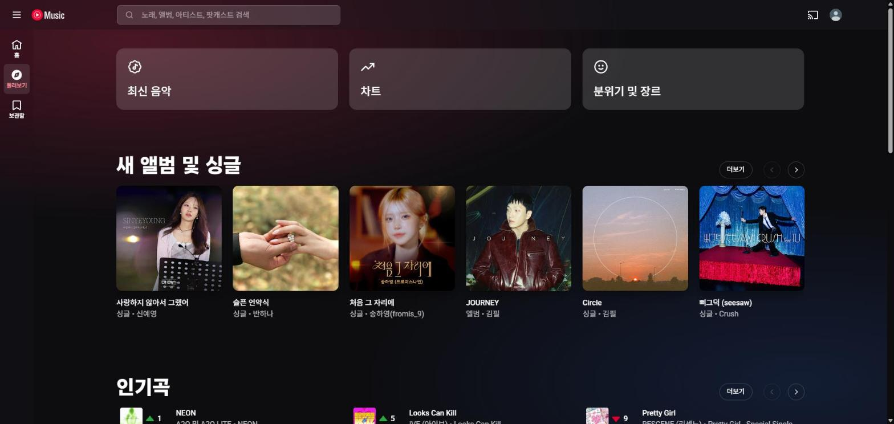
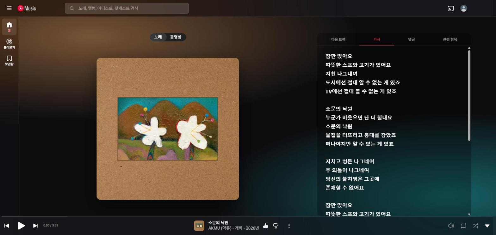

# Albumglow

검정 일색인 유튜브 뮤직(music.youtube.com)을 **애플 뮤직 스타일**로 바꿔 주는 Chrome 확장 프로그램입니다. (YouTube Music용 앨범 색 테마)
재생 중인 앨범 색이 배경 그라데이션이 되고, 상단 바와 플레이어 바는 반투명 유리처럼 보입니다.




## 기능

- **앨범 색 그라데이션 배경** — 곡이 바뀌면 앨범 아트에서 뽑은 색으로 부드럽게 전환됩니다.
- **유리 느낌 UI** — 상단 바, 플레이어 바, 사이드바에 반투명 블러를 적용합니다.
- **애플 뮤직 스타일** — 둥근 모서리와 그림자, 레드 강조색, 읽기 좋은 폰트.
- **재생 화면과 가사** — 앨범 아트를 크게, 가사는 크고 굵게 보여 줍니다.
- **가사 따라가기** — 지금 부르는 줄만 밝게 보이고 가운데로 자동 스크롤됩니다. 줄을 누르면 그 위치로 이동하고, 직접 가사를 넘겨 보는 동안은 자동 스크롤이 잠시 멈춥니다. 줄별 시간 정보는 공개 가사 DB [LRCLIB](https://lrclib.net)에서 받아오며, 팝업에서 끌 수 있습니다.
- **팝업 설정** — 툴바 아이콘을 눌러 프리셋과 세기를 바꿉니다. 설정은 저장되고 즉시 반영됩니다.
- **단축키** — `Alt+Shift+Y` 로 테마를 켜고 끕니다.

### 프리셋

| 프리셋 | 설명 |
|---|---|
| 애플 뮤직 | 배경이 앨범 색을 따라가고 강조색은 레드입니다. (기본값) |
| 딥 다크 | 앨범 색을 따르지 않고, 순검정 바탕에 어두운 와인색·남색 그라데이션을 고정합니다. |
| 단색 강조색 | 배경은 애플 뮤직과 같고, 강조색만 직접 고른 색으로 바꿉니다. |

팝업에서 **블러 세기**와 **그라데이션 세기**도 조절할 수 있습니다.

## 설치

Chrome Web Store에는 올라와 있지 않으므로 직접 설치합니다. (Chrome 111 이상)

1. [Releases](../../releases)에서 `albumglow-v*.zip` 을 받아 압축을 풉니다.
   (저장소를 직접 받았다면 이 폴더를 그대로 쓰면 됩니다.)
2. Chrome 주소창에 `chrome://extensions` 를 입력합니다.
3. 오른쪽 위 **개발자 모드**를 켭니다.
4. **압축해제된 확장 프로그램을 로드합니다** 를 눌러 압축을 푼 폴더를 선택합니다.
5. music.youtube.com 을 열고 곡을 재생합니다. 이미 열려 있다면 새로고침하세요.

Edge, Brave 등 Chromium 기반 브라우저에서도 같은 방법으로 설치할 수 있습니다. (Chrome에서만 확인했습니다.)

### 단축키가 안 먹을 때

`chrome://extensions/shortcuts` 에서 "테마 켜기/끄기"에 키가 지정돼 있는지 확인하세요.
크롬이 이미 쓰는 키와 겹치면 자동 지정이 안 되니, 비어 있으면 직접 지정하면 됩니다.

## 개인정보

- 수집하는 개인 정보는 없습니다.
- **가사 따라가기가 켜져 있으면** 곡이 바뀔 때마다 재생 중인 곡의 제목과 가수를 `lrclib.net` 으로 보내 가사를 조회합니다. 쿠키, 계정 정보, 현재 페이지 주소는 보내지 않습니다. 팝업에서 "가사 따라가기"를 끄면 이 요청은 나가지 않습니다.
- 설정(프리셋, 세기, 강조색, 가사 따라가기, 켜짐 여부)은 `chrome.storage.sync` 에만 저장됩니다. 로그인한 Chrome 계정으로 동기화될 수 있습니다.
- 앨범 색을 뽑기 위해 유튜브 뮤직이 이미 쓰는 이미지 서버에서 앨범 이미지를 한 번 더 불러옵니다. 위 두 가지 외의 네트워크 요청은 없습니다.
- 권한은 `storage` 하나이고, `music.youtube.com` 페이지에서만 동작합니다.

## 알려진 한계

- **유튜브 뮤직 화면 구조가 바뀌면** 일부 스타일이 깨질 수 있습니다. 이 확장은 유튜브 뮤직의 내부 요소 이름에 기대고 있습니다. 문제가 보이면 이슈로 알려 주세요.
- **가사 따라가기는 LRCLIB에 시간 정보가 있는 곡에서만 됩니다.** 웹 유튜브 뮤직의 가사에는 줄별 동기화 정보가 없습니다. 곡을 못 찾거나, 유튜브 뮤직에 가사 자체가 없는 곡이거나, 곡 길이가 2초 넘게 다른 버전만 있으면 원래 가사가 그대로 보입니다.
- 재생 화면을 열 때 약 1초 걸리는 것은 유튜브 뮤직 자체의 동작이며, 이 확장을 꺼도 같습니다.
- 라이트 테마는 없습니다.

## 개발

빌드 도구 없이 순수 JS/CSS로 되어 있습니다.

```
manifest.json        MV3 매니페스트
background.js        단축키 처리 (서비스 워커)
content/theme.css    테마 스타일 (CSS 변수 기반)
content/content.js   앨범 색 추출, 가사 따라가기, 설정 반영
popup/               툴바 팝업 (프리셋·슬라이더)
icons/               아이콘
scripts/package.ps1  배포용 ZIP 만들기
```

- 코드를 고친 뒤에는 `chrome://extensions` 에서 확장의 새로고침 버튼을 누르고 유튜브 뮤직 탭을 새로고침합니다.
- 유튜브 뮤직 요소 이름이 바뀌었을 때는 `content/theme.css` 의 셀렉터와 `content/content.js` 맨 위의 `SEL` 을 고치면 됩니다.
- 배포용 ZIP 만들기 (Windows): `powershell -ExecutionPolicy Bypass -File scripts/package.ps1` → `dist/albumglow-v<버전>.zip`

## 안내

이 프로젝트는 개인이 만든 비공식 확장 프로그램이며 YouTube, Google, Apple과 관련이 없습니다.
"YouTube", "YouTube Music"은 Google LLC의, "Apple Music"은 Apple Inc.의 상표입니다.
"애플 뮤직 스타일"은 화면 분위기를 가리키는 표현일 뿐입니다.

## 라이선스

[MIT](LICENSE)
